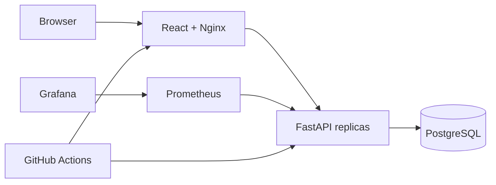

# StudentSphere Cloud

StudentSphere Cloud is a production-shaped, cloud-native Student Management and Student Success platform. It goes beyond basic CRUD by combining academic workflows, role-based security, explainable risk scoring, auditability, operational health checks, metrics, containers, CI/CD, and Kubernetes autoscaling.

## Why this qualifies as cloud-native

| Area | Implementation |
|---|---|
| Containerization | Separate optimized Docker images for React/Nginx and FastAPI |
| External state | PostgreSQL supplied through `DATABASE_URL`; API remains stateless |
| Resilience | Liveness and database-aware readiness probes |
| Observability | Prometheus metrics, request latency, request totals, Grafana datasource |
| Security | JWT sessions, PBKDF2 password hashing, RBAC, non-root API container |
| Automation | GitHub Actions tests, frontend build, and container publishing |
| Orchestration | Kubernetes Deployments, Services, resource limits, probes, HPA |
| Portability | Docker Compose locally; Render/Vercel now; Kubernetes/AWS later |

## Functional modules

- Separate administrator, teacher, and student access
- Student and course management with enrollment workflows
- Attendance and assessment recording
- Automatic early-risk score based on attendance and grades
- Department analytics, course utilization and intervention insights
- Immutable-style audit activity log
- Cloud health and observability status panel
- Interactive OpenAPI documentation

## Run the complete platform with Docker

Prerequisite: Docker Desktop.

```bash
git clone <your-repository-url>
cd student-cloud
docker compose up --build
```

Open:

- Application: http://localhost:3000
- API documentation: http://localhost:8000/api/docs
- Prometheus: http://localhost:9090
- Grafana: http://localhost:3001 (admin / admin)

Demo accounts:

| Role | Email | Password |
|---|---|---|
| Admin | `admin@studentsphere.edu` | `Admin@123` |
| Teacher | `teacher@studentsphere.edu` | `Teacher@123` |
| Student | `student@studentsphere.edu` | `Student@123` |

## Run without Docker

Backend:

```bash
cd backend
python -m venv .venv
source .venv/bin/activate  # Windows: .venv\Scripts\activate
pip install -r requirements.txt
uvicorn app.main:app --reload
```

Frontend in a second terminal:

```bash
cd frontend
npm install
npm run dev
```

The backend uses SQLite automatically for a simple non-Docker demonstration. Docker and cloud environments use PostgreSQL.

## Free public deployment: Render + Vercel

1. Push this folder to a GitHub repository.
2. In Render, choose **New > Blueprint**, connect the repository, and select `render.yaml`.
3. Copy the deployed Render API URL.
4. In Vercel, import the same repository and set the Root Directory to `frontend`.
5. Add `VITE_API_URL=https://YOUR-RENDER-API.onrender.com/api/v1` in Vercel.
6. Replace `YOUR-VERCEL-PROJECT` in `render.yaml` with the Vercel domain, then redeploy the API.

The GitHub Actions workflow provides CI quality gates and publishes container images on pushes to `main`.

## Kubernetes demonstration

Update the image names and secret values in `k8s/`, then run:

```bash
kubectl apply -f k8s/namespace.yml
kubectl apply -f k8s/config.yml
kubectl apply -f k8s/api.yml
kubectl apply -f k8s/web.yml
kubectl get all -n student-cloud
```

Show the teacher the two replicas, health probes and Horizontal Pod Autoscaler:

```bash
kubectl describe deployment student-cloud-api -n student-cloud
kubectl get hpa -n student-cloud
```

## API verification

```bash
curl http://localhost:8000/health/live
curl http://localhost:8000/health/ready
curl http://localhost:8000/metrics
```

## Architecture



## Project structure

```text
student-cloud/
├── backend/              FastAPI service, models, auth and tests
├── frontend/             React dashboard and Nginx image
├── monitoring/           Prometheus and Grafana provisioning
├── k8s/                  Kubernetes workloads, probes and autoscaling
├── .github/workflows/    CI/CD pipeline
├── docker-compose.yml    Local multi-container platform
└── render.yaml           Public cloud deployment blueprint
```

